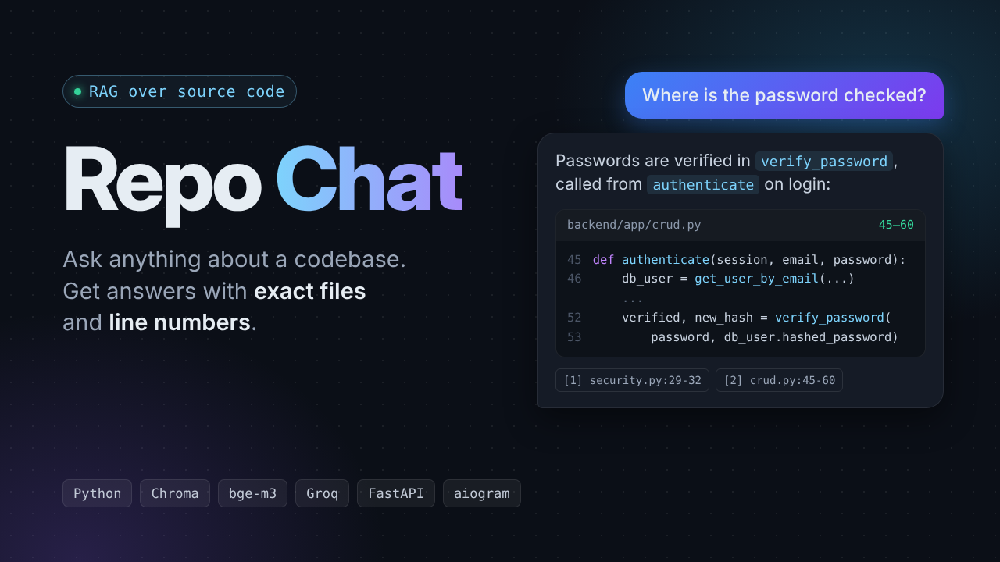

# Repo Chat

A Telegram bot that answers questions about a Python codebase. Ask "where is the user password checked?" or "how does password recovery work?" and it replies with the relevant functions, file paths and line numbers.

Try it in Telegram: [@repo_chat_rag_bot](https://t.me/repo_chat_rag_bot)

It is a retrieval-augmented generation (RAG) system: the repository is split into functions and classes, embedded into a vector index, and the closest pieces of code are passed to an LLM that answers only from them. The quality of both search and answers is measured on a 40-question test set.



The demo instance indexes [fastapi/full-stack-fastapi-template](https://github.com/fastapi/full-stack-fastapi-template), a FastAPI backend with users, JWT login, password recovery, roles and CRUD endpoints. Any public Python repository can be indexed by changing `REPO_URL`.

## How it works

```
Telegram ─► bot (aiogram) ─► FastAPI /ask ─► retriever ─► Groq LLM ─► answer with sources
                                              │
                                              ├─ bge-m3 embeddings
                                              └─ Chroma vector index
```

1. `chunker.py` clones the repository and parses every `.py` file with Python's `ast` module. Each function and method becomes one chunk; a class gets a summary chunk with its docstring, attributes and method signatures; remaining module-level code becomes a separate chunk. Imports are dropped because they matched many queries without answering any. Chunks longer than 120 lines are split with a 15-line overlap, and files that fail to parse fall back to line windows.
2. `index.py` embeds every chunk together with its path, name, signature and docstring, and stores it in a persistent Chroma collection (one collection per embedding model).
3. `retriever.py` finds the top 5 chunks for a question. Test files are excluded by default. A hybrid mode (vector search plus a small BM25 implementation merged with reciprocal rank fusion) is available but not the default, see the results below.
4. `rag.py` sends the numbered chunks, with real line numbers, to the LLM. The prompt requires answers only from the sources, citations in the form `[n] path:start-end`, the language of the question, and a plain "not found" when the code does not contain the answer.
5. `api.py` serves `/ask`, `/search` and `/health`. `bot.py` is a thin Telegram client for that API and converts the Markdown answer to Telegram HTML.

Stack: Python 3.14, sentence-transformers (BAAI/bge-m3), Chroma, Groq (openai/gpt-oss-120b), FastAPI, aiogram 3, Docker Compose, Ansible, GitLab CI, Oracle Cloud.

## Evaluation

All numbers come from `eval/questions.jsonl`: 40 questions about the demo repository, 20 in Russian and 20 in English. Each question lists the chunks that contain the answer and the reference facts a correct answer must include. Five of them ask about features the repository does not have (Stripe, S3, Redis, Google login, rate limiting); the correct answer to those is that nothing was found.

### Retrieval

`eval_retrieval.py` checks whether an expected chunk is in the top k. Hit@1 is the share of questions where it is ranked first, MRR is the mean reciprocal rank.

First 15 questions, comparing setups:

| Setup | Hit@1 | Hit@5 | MRR |
|---|---|---|---|
| multilingual-e5-small, vector | 0.67 | 0.73 | 0.70 |
| multilingual-e5-small, BM25 only | 0.20 | 0.33 | 0.27 |
| multilingual-e5-small, hybrid (vector + BM25) | 0.53 | 0.73 | 0.62 |
| multilingual-e5-base, vector | 0.67 | 0.93 | 0.79 |
| bge-m3, vector | 0.53 | 1.00 | 0.71 |

Hybrid search made results worse here. BM25 matched words such as `item` in "где удаляется item?" and pushed `create_item` above `delete_item`, and Russian questions give it nothing to match in English code. bge-m3 ranks the right chunk first less often than e5-base but finds it in the top 5 every time, and since the LLM reads all five chunks, Hit@5 matters more. bge-m3 is the default.

On all 35 questions that have an expected chunk, bge-m3 reaches Hit@5 0.97 (Hit@1 0.66, MRR 0.79). Increasing k to 8 does not change Hit@k, so k stays at 5.

### Answers

`eval_answers.py` runs the full pipeline for every question, then an LLM judge scores correctness (against the reference facts) and groundedness (every claim supported by the retrieved code) from 1 to 5. An answer passes when both scores are at least 4.

| Run | Judge | Pass rate | Correctness | Groundedness | Not-found questions |
|---|---|---|---|---|---|
| baseline, 40 questions | gpt-oss-120b | 0.88 | 4.60 | 4.75 | 5 of 5 |
| baseline, re-judged | gpt-oss-20b | 0.93 | 4.70 | 4.80 | 5 of 5 |

Average answer time was about 5 seconds.

On the same 39 answers the two judges agreed on pass or fail in 37 cases. Differences of one or two questions between runs are within judge noise, so a later prompt change (line numbers in the context) is not counted as an improvement even though one judge scored it higher. The judges also make mistakes: in one case the answer correctly said the code shown did not configure CORS and still got groundedness 1.

`eval_citations.py` checks every `[n] path:start-end` citation against the chunks the model actually received, without an LLM. 30 of 31 citations in the baseline run were valid; the one error pointed `verify_password` to `utils.py` instead of `security.py`.

### Known failures

- The CORS settings sit in a module-level chunk of `main.py` together with Sentry, app creation and router setup. That chunk is too mixed to match "как настроен CORS?", so retrieval misses it.
- Some answers need a value defined in another file. "How long is a login access token valid?" retrieves the login endpoint, which reads `settings.ACCESS_TOKEN_EXPIRE_MINUTES`, but not `config.py`, where the default of 8 days is set. The answer names the setting without the number.

## Run locally

```
python -m venv .venv
.venv\Scripts\activate          # Linux/macOS: source .venv/bin/activate
pip install -r requirements.txt
copy .env.example .env          # then fill in GROQ_API_KEY and TELEGRAM_BOT_TOKEN

python chunker.py https://github.com/fastapi/full-stack-fastapi-template
python index.py
python search.py "where is the user password checked?"
python rag.py "how does password recovery work?"

uvicorn api:app                 # http://127.0.0.1:8000/docs
python bot.py                   # in a second terminal
```

Evaluation:

```
python eval_retrieval.py --note "my change"
python eval_answers.py --tag my-change
python eval_answers.py --tag my-change --rejudge   # re-score saved answers with JUDGE_PROVIDER / JUDGE_MODEL
python eval_citations.py
```

Answer runs are cached in `eval/runs/<tag>.jsonl`, so a run stopped by a rate limit continues where it stopped. Results are appended to `eval/history.csv` and `eval/answers_history.csv`.

## Deployment

The bot runs on an Oracle Cloud Always Free ARM instance (1 OCPU, 6 GB RAM, Ubuntu 20.04).

- `Dockerfile` builds one image for both services. `compose.yaml` runs `api` and `bot`; the API port is bound to localhost only, and the bot reaches it over the Compose network. The bot uses long polling, so no port is open to the internet besides SSH.
- On first start the container clones the repository, builds the chunks and the index, and keeps them in a Docker volume. On the server this takes about 20 minutes, so later deploys reuse the volume and skip it. `docker compose run --rm api reindex` rebuilds it.
- `ansible/playbook.yml` prepares a fresh Ubuntu host: a 4 GB swap file, Docker from the official repository, the application code, an `.env` written with mode 600, `docker compose up --build`, and a wait until `/health` reports ok.
- `.gitlab-ci.yml` runs `ruff` and 14 unit tests on every push. On `main` it packs the commit with `git archive` and runs the playbook against the server. Deploys are serialized with a resource group.

CI/CD variables: `SSH_PRIVATE_KEY` (file), `SERVER_IP`, `GROQ_API_KEY`, `TELEGRAM_BOT_TOKEN`.

Things that broke on the way and are now handled: Ubuntu 20.04 ships Python 3.8, which the newest ansible-core no longer supports on the target, so CI pins ansible-core 2.18; `/etc/apt/keyrings` does not exist there by default; and the first index build on one ARM core is slower than the original health-check window, so the bot no longer waits for the API to be healthy and the first-start timeouts are longer.

## Limits

- Only Python is parsed into functions and classes.
- Groq's free tier allows 200,000 tokens per day for gpt-oss-120b. A full answer evaluation uses about half of that, so the judge runs on a separate model to leave quota for the bot.
- The 40-question set is small. One question moves a metric by 2.5 points, which is why changes within that range were not tuned further.

## Project layout

| File | Purpose |
|---|---|
| `chunker.py` | AST-based chunking of a repository |
| `index.py` | embeddings and Chroma index |
| `retriever.py` | vector, BM25 and hybrid search |
| `rag.py` | prompt, Groq call, CLI |
| `api.py` | FastAPI server |
| `bot.py`, `tg_format.py` | Telegram bot and message formatting |
| `config.py` | models, paths, settings |
| `eval_retrieval.py`, `eval_answers.py`, `judges.py`, `eval_citations.py` | evaluation |
| `eval/questions.jsonl` | test questions with expected chunks and reference facts |
| `Dockerfile`, `compose.yaml`, `docker/entrypoint.sh` | containers |
| `ansible/`, `.gitlab-ci.yml` | provisioning and CI/CD |
| `tests/` | unit tests |
